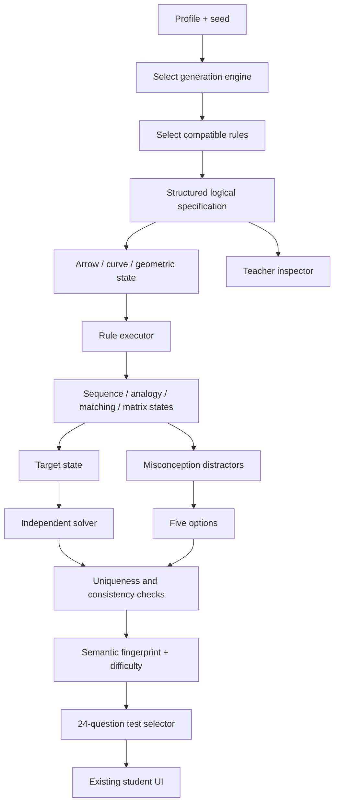

# Dynamic NVR Engine — Architecture Report (v3.1)

## Executive assessment

The timed-test path uses a logic-first generator. v3.1 adds a second structured-object system for multi-arrow configurations and irregular curves/doodles. The application now has two cooperating logical generation engines behind the same `DynamicReasoning.makeQuestion()` / `DynamicReasoning.validate()` interface:

- the original structured geometric/component engine;
- the advanced object engine, selected for a share of generated questions and specialised for arrows and curves.

Both output the same question contract used by the existing five-choice test UI. The original 62 legacy family generators remain available for learning/review and compatibility.

## Previous architecture versus current architecture

| Area | Previous template-led engine | v3 logic-first engine | v3.1 addition |
|---|---|---|---|
| Reasoning source | Rules mostly embedded in individual family generators | Structured state + reusable transformation rules | Arrow-group and curve-stroke state models with dedicated reusable operations |
| Figure types | Polygons, dots, grids, nested shapes, lines, symbols | Same, generated from logical specification | Multi-arrow groups and irregular smooth doodles |
| Composition | Limited `composedAnalogy` | Simultaneous, alternating, matrix and invariant composition | Simultaneous and alternating object-rule composition |
| Correct answer | Generator-keyed option | Independently re-derived state | Separate arrow/curve solver, independent of object-rule executor |
| Distractors | Mostly fixed or generic mutation | Omitted/reversed/misapplied rule patterns | Wrong arrow direction, wrong arrow position, arrow count, omitted rule, wrong curve segment, extra/missing loop and scale errors |
| Diversity | Family IDs and visual signatures | Cognitive skill + ordered rule composition + format + difficulty | Adds object type and arrow/curve rule combinations |

## Component map

## Modules

- `js/dynamicReasoningEngine.js` — original 21 transformation primitives, three classification invariants, rule composition, matrix construction, independent solver, distractors, semantic fingerprints and difficulty.
- `js/advancedObjectReasoning.js` — seven multi-arrow rules and nine irregular-curve rules; arrow/doodle state generation; simultaneous and alternating composition; object-specific misconception options; independent object solver; structured SVG rendering.
- `js/figureRenderer.js` — renderer for original figure types. The advanced module extends `FigureKit.renderFigure()` for `arrowGroup` and `doodle` states.
- `js/testEngine.js` — builds 24-question / 10-minute tests through the shared dynamic interface, sorts by difficulty, balances answer positions and avoids semantic fingerprints in the rolling ten-test history.
- `js/app.js` — preserves test, learning, review, scoring, navigation, saved progress and teacher inspection. The teacher inspector displays object type and rule definitions when available.
- `js/geometryKernel.js` — straight-line intersection/topology metrics, including the collinear-overlap graph correction.
- `js/questionGenerators.js`, `js/diversityEngine.js`, `js/diversityExpansion.js`, `js/ruleComposition.js` — retained legacy generators and comparison support.

## What is genuinely dynamic in v3.1

### Multi-arrow configurations

An arrow is represented by an object with an ID, spatial slot, x/y position and direction. Rules can act on all arrows as a group or on selected relationships. Group rotation changes both positions and directions; direction-only rotation leaves positions unchanged; position cycling leaves directions unchanged; direction exchange swaps direction attributes without swapping positions; count rules add or remove arrows.

### Irregular curves and doodles

A doodle is represented as a collection of typed strokes. Each stroke has control points and a closure flag; stroke types distinguish the main line, closed loops and open lobes. Rules can rotate or reflect every stroke, change scale, add/remove loops or lobes, and add a bend to the main stroke. The renderer converts the structured control points into smooth SVG paths. The visual SVG is not used as the source of truth.

### Independent validation

`advancedObjectReasoning.js` has a separate `independentObjectSolve()` switch implementation. It does not call `applyArrowRule()`, `applyCurveRule()` or `applyRules()`. The validator reconstructs the expected structured state and checks that exactly one of the five answer options matches it. Duplicate options and incomplete misconception metadata reject the question.

### Shared test adapter

The advanced object engine wraps `DynamicReasoning.makeQuestion()` and `.validate()` rather than changing the student UI contract. The existing app can render the new figure kinds through `FigureKit.renderFigure()`. Learning mode and the teacher bank inspector can also request dynamic questions through the same interface.

## Preserved and repaired behaviour

- Existing 24-question / 10-minute timed test, five options, navigation, scoring, results and saved-progress interfaces are retained.
- The 62 legacy generator families remain callable.
- The `matrixRows` figure renderer is present.
- Matrix rule pairs are now screened across the complete 3×3 progression so bounded operations cannot silently stop changing the state midway through a row or column.
- Collinear overlap contributes both overlap endpoints to the topology graph.
- Static fallback questions do not conceal failed generation.
- The teacher inspector exposes the new object system and detailed rule definitions.

## Remaining architectural boundary

The core and advanced object engines share the app/test adapter and question contract, but their state schemas and solver registries are still separate. A future unification could define a typed object graph that represents polygons, arrows, curves, line segments and nested components under one common state model. v3.1 deliberately avoids rewriting the original engine while adding the requested question types.

The arrow model currently uses cardinal directions and an eight-slot anchor ring. The curve model handles smooth paths, bends, loops and lobes but not general self-intersection or topology reasoning. Neither is an unrestricted geometry engine.
